# Lab 1: Automated User Provisioning with SCIM 2.0 in Okta

> **Status:** ✅ Complete (joiner ✅ · mover ⚠️ · leaver ✅, with the test-server limitation documented below)
> **Platform:** Okta Workforce Identity Cloud (Admin Console)
> **SCIM target:** [SCIM Playground (scim.dev)](https://scim.dev), free simulated plan
> **Skills:** SCIM 2.0, lifecycle management (joiner / mover / leaver), custom SCIM connector, HTTP Header auth, System Log troubleshooting

---

## 📌 Objective

Configure Okta to automatically **create, update, and deactivate** user accounts in a downstream application using **SCIM 2.0**, making Okta the source of truth for the user lifecycle and removing manual account management.

## 🧠 Why This Matters

Without provisioning, IT creates accounts by hand in every app, and leavers' accounts often stay active. That's a security and audit risk. **SCIM** (System for Cross-domain Identity Management, RFC 7643/7644) is the open standard that lets an identity provider manage accounts in apps over a REST API.

| Lifecycle event | Okta action | SCIM call |
|---|---|---|
| **Joiner:** user assigned to app | Create account | `POST /Users` |
| **Mover:** Okta profile changes | Update attributes | `PUT/PATCH /Users/{id}` |
| **Leaver:** user unassigned / deactivated | Disable account | `PATCH /Users/{id}` → `active: false` |
| **Group push** | Sync groups | `POST/PATCH /Groups` |

## 🏗️ Architecture

```
┌───────────────────┐   SCIM 2.0 over HTTPS (REST + JSON)   ┌──────────────────────────┐
│       Okta        │ ────────────────────────────────────► │  scim.dev (SCIM server)  │
│ (IdP, source of   │   Authorization: Bearer <token>       │  /scim/v2/Users          │
│  truth for users) │ ◄──────────────────────────────────── │  /scim/v2/Groups         │
└───────────────────┘        201 / 200 / 400 / 401          └──────────────────────────┘
```

## 🧰 Environment

| Item | Value |
|---|---|
| Okta org | Okta Workforce Identity demo/trial org |
| Final app | Custom SAML 2.0 app with SCIM provisioning (`SCIM Okta LAB`) |
| SCIM base URL | `https://api.scim.dev/scim/v2` |
| Auth | HTTP Header, Bearer token (scim.dev shared free token) |
| Test users | Kobe Bryant (clean profile), plus pre-built demo users for comparison |

> ⚠️ scim.dev's free plan is a **shared, simulated, non-persistent** environment: changes reset after every request. This matters later (see Results).

---

## 🛠️ Build Steps (final working path)

> I tried the OIN catalog app first and switched to a custom app partway through. That attempt is documented under [Troubleshooting](#-troubleshooting-what-went-wrong-and-how-i-fixed-it).

### Step 1: Get a SCIM target
1. Go to **https://scim.dev** and open the Playground.
2. Note the **token** and **base URL** shown on the page. The page says the token is sent as `Authorization: Bearer <token>`.

### Step 2: Create a custom SAML app
1. **Applications → Applications → Create App Integration**

   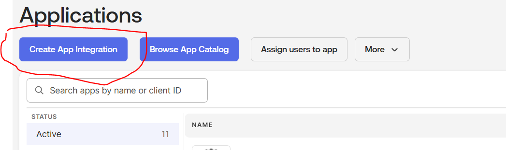

2. Select **SAML 2.0** → **Next**. Enter an **App name** → **Next**.

   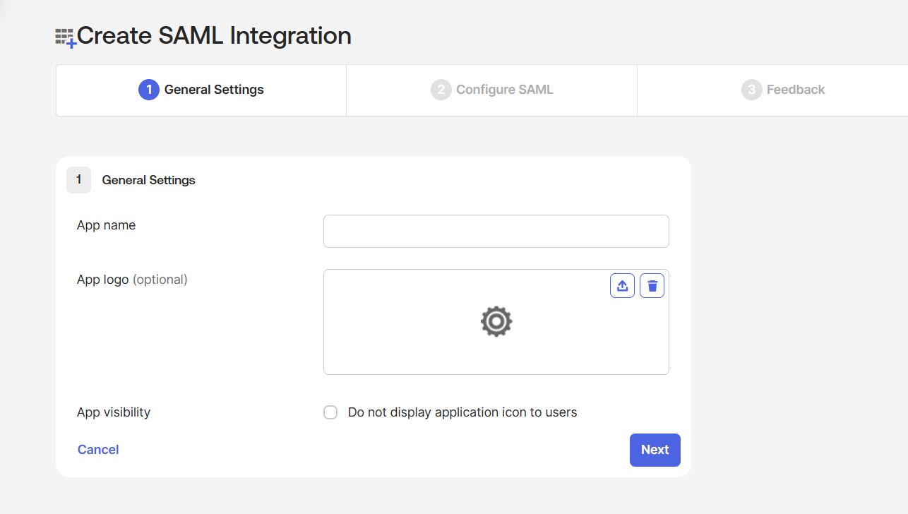

3. **SAML Settings:** set **Single sign-on URL** and **Audience URI (SP Entity ID)** both to `https://scim.dev/`. Leave everything else at the defaults. SSO isn't the focus of this lab; the SAML app just gives SCIM a place to live.

   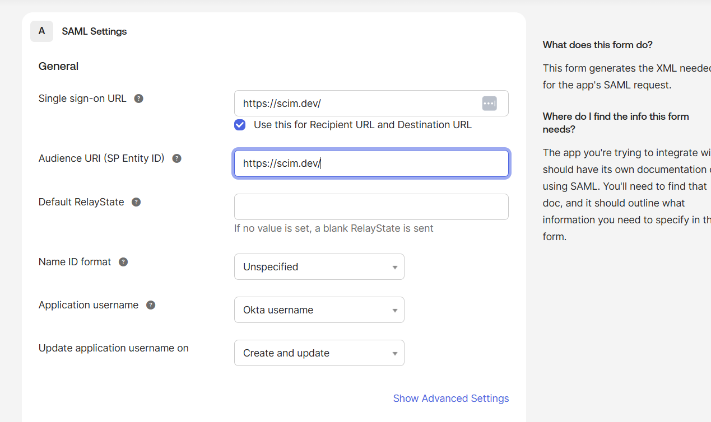

4. **Feedback:** check **"This is an internal app that we have created"** → **Finish**.

   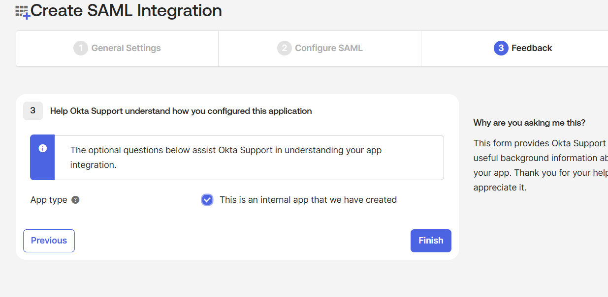

✅ **You should see:** the new app's page with General, Sign On, and Assignments tabs.

### Step 3: Enable SCIM provisioning
1. **General** tab → **App Settings → Edit**
2. Set **Provisioning** to **SCIM** → **Save**

   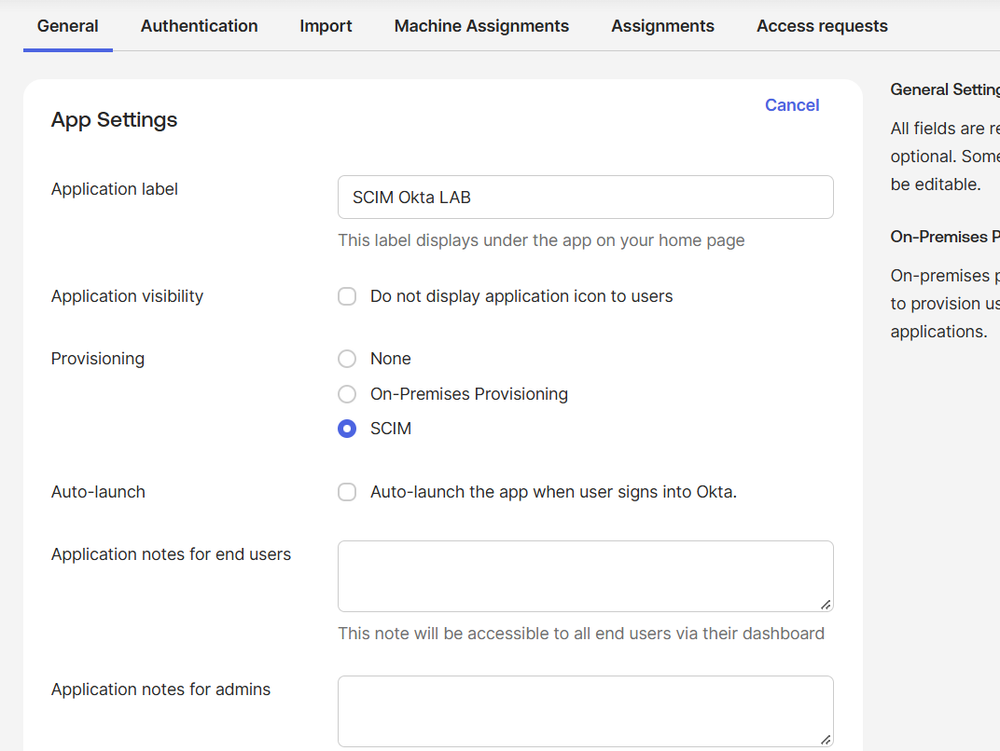

✅ **You should see:** a new **Provisioning** tab.

### Step 4: Configure the SCIM connection
1. **Provisioning → Integration → Edit**. The default Authentication Mode is **Basic Auth**, which needs changing.

   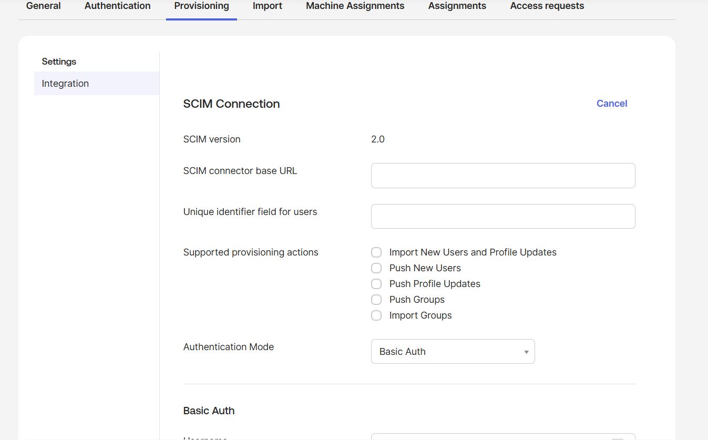

2. Fill in:

   | Field | Value |
   |---|---|
   | SCIM connector base URL | `https://api.scim.dev/scim/v2` |
   | Unique identifier field for users | `userName` |
   | Supported provisioning actions | All 5 checked |
   | Authentication Mode | **HTTP Header** |
   | Authorization | **token only**, because Okta shows a built-in grey `Bearer` prefix |

   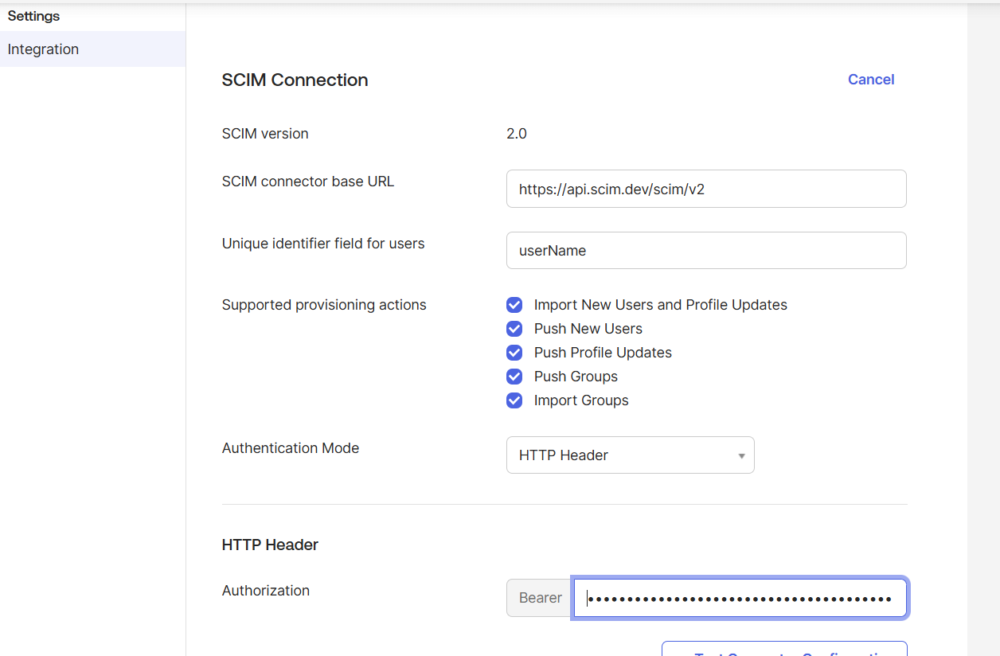

3. **Test Connector Configuration**

   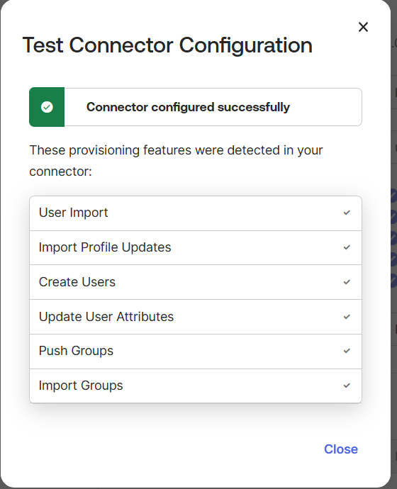

✅ **You should see:** "Connector configured successfully" with the features detected: User Import, Import Profile Updates, Create Users, Update User Attributes, Push Groups, Import Groups.

4. Close the popup → **Save**. **To App** and **To Okta** now appear in the left menu.

### Step 5: Enable provisioning actions
1. **Provisioning → To App → Edit**
2. Enable **Create Users**, **Update User Attributes**, and **Deactivate Users**. Leave **Sync User Password** off.
3. **Save**

   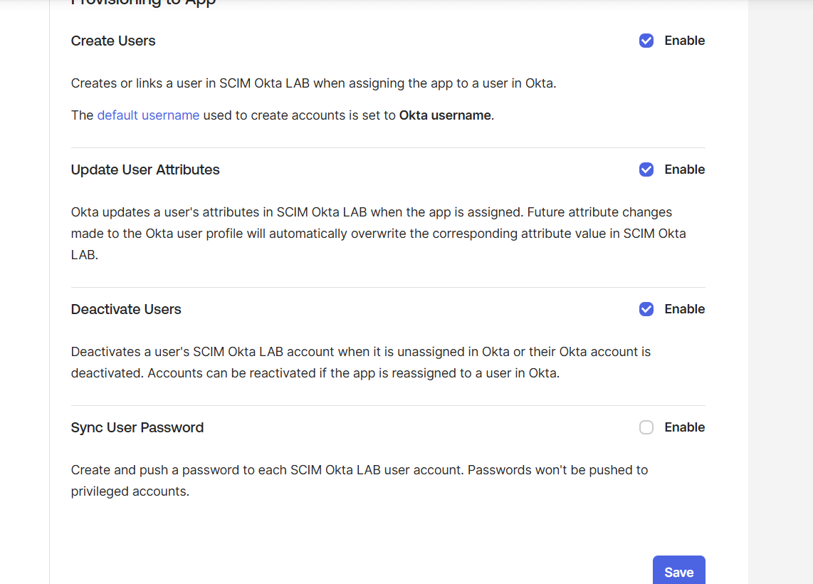

### Step 6: Joiner test (assign a user)
1. **Assignments → Assign → Assign to People** → select the test user → **Assign**
2. A form shows how Okta maps the user's profile to SCIM attributes. Leave it as is → **Save and Go Back → Done**

   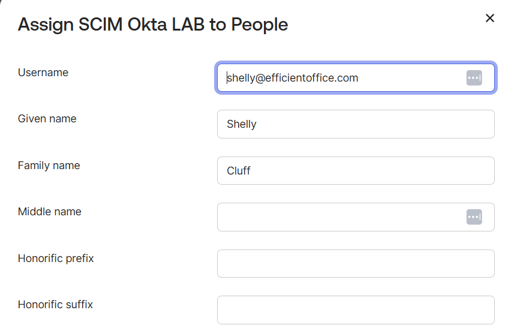
   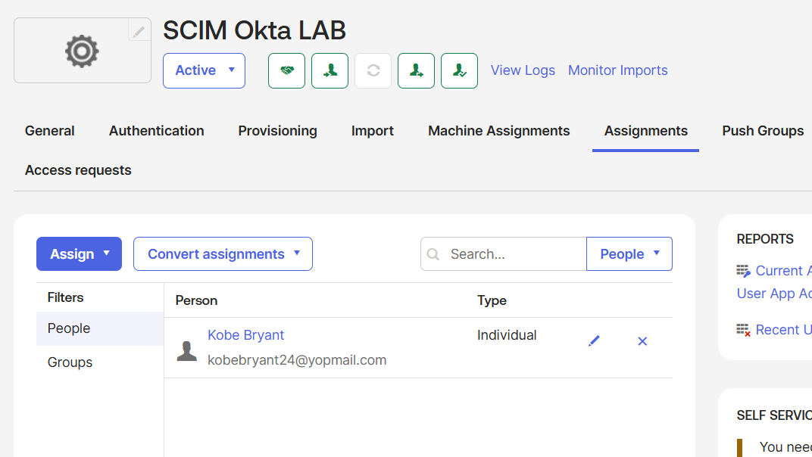

3. Verify in **View Logs** (System Log filtered to the app):

   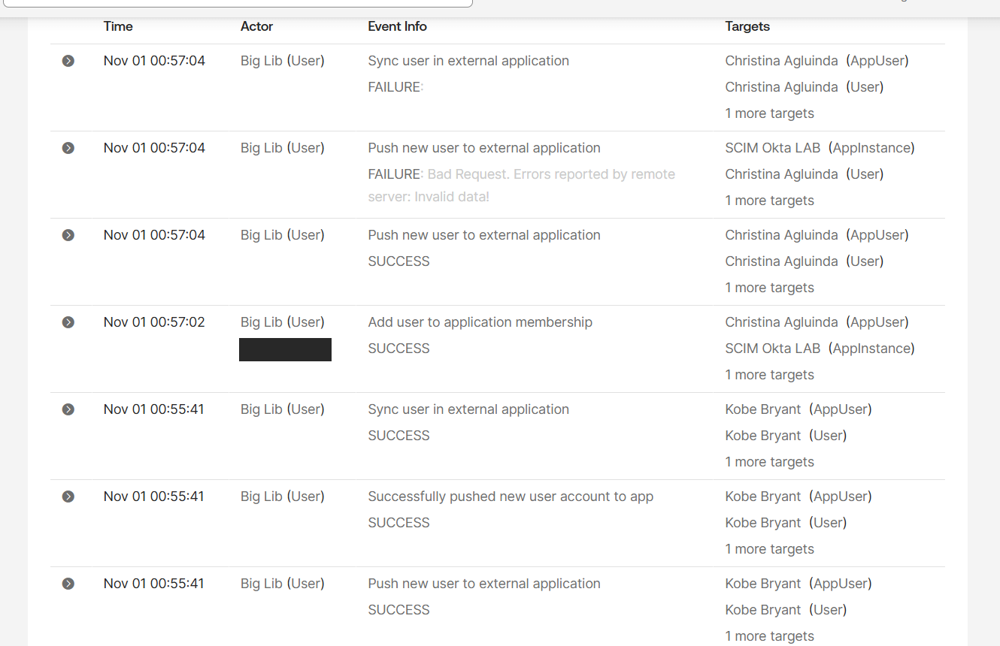

✅ **Kobe Bryant:** `Push new user to external application` SUCCESS → `Successfully pushed new user account to app` SUCCESS → `Sync user in external application` SUCCESS.

### Step 7: Mover test (update profile)
1. **Directory → People → Kobe Bryant → Profile → Edit** → change Last name to `Bryant-Test` → **Save**
2. **View Logs:**

   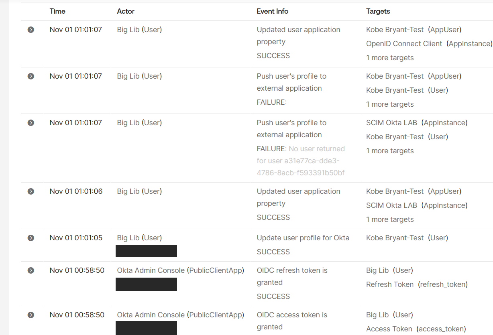

⚠️ `Update user profile for Okta` SUCCESS, but `Push user's profile to external application` FAILURE: **"No user returned for user &lt;id&gt;"**. See Results for why.

### Step 8: Leaver test (unassign)
1. **Assignments → ✕** next to Kobe → confirm
2. **View Logs:**

   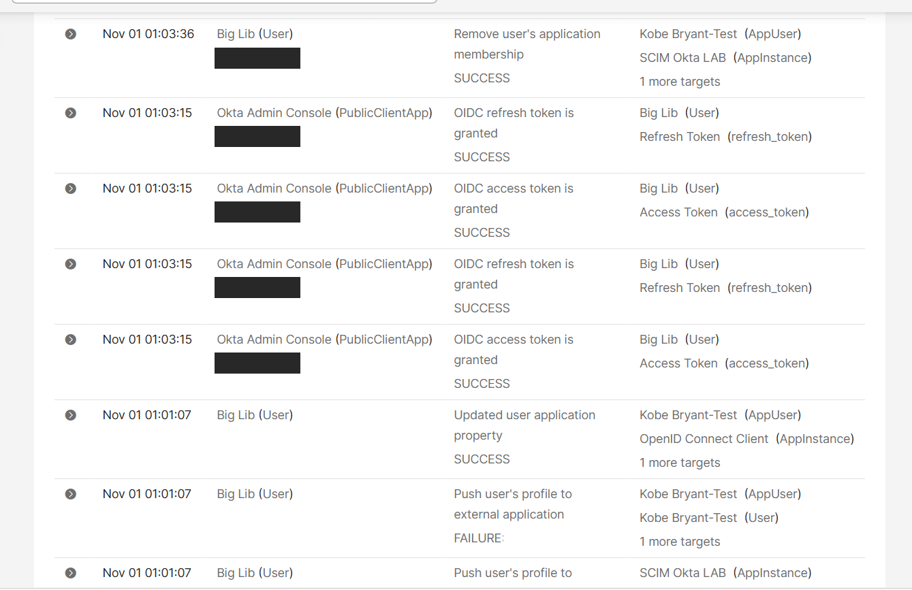

✅ `Remove user's application membership` SUCCESS. Okta removed access as soon as the user was unassigned.

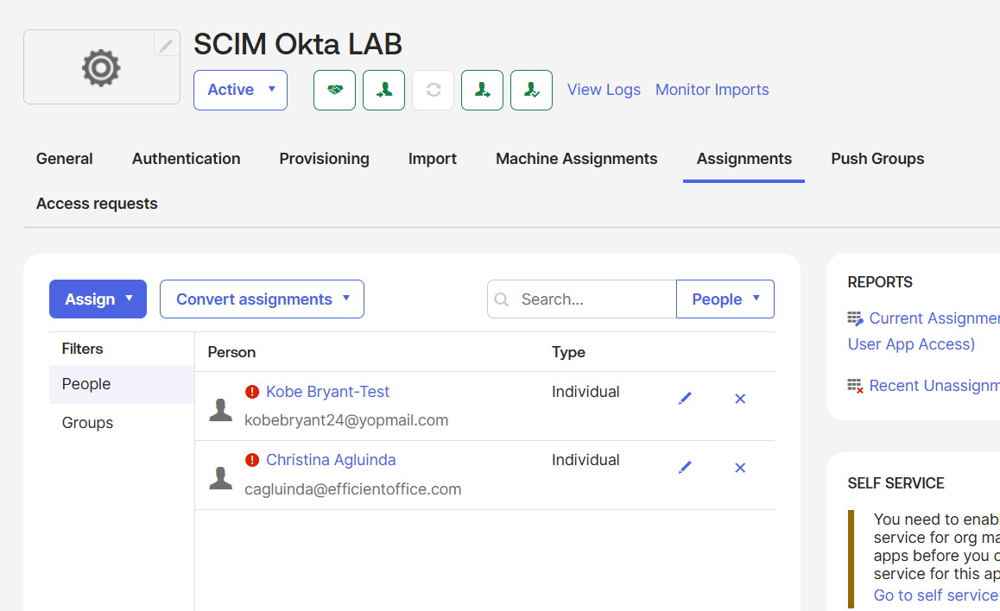

---

## ✅ Results

| Test | Expected | Result |
|---|---|---|
| Connector test | "Configured successfully" | ✅ Pass |
| Joiner: assign user → account created | `POST /Users` 201 | ✅ Pass (Kobe Bryant) |
| Joiner: pre-built demo users | Account created | ❌ 400 "Invalid data!" (see Troubleshooting) |
| Mover: profile update pushed | `PUT/PATCH` succeeds | ⚠️ Okta sent it; target returned "No user returned" |
| Leaver: unassign → access removed | Membership removed / deactivated | ✅ Membership removal SUCCESS |
| Events visible in System Log | All events logged | ✅ Pass |

**Why the mover test failed:** scim.dev's free plan is *"Simulated — non-persistent, changes reset after every request."* Okta created the user, scim.dev discarded it, and when Okta came back to update the user by SCIM ID, the user no longer existed. **Okta behaved correctly.** It detected the change and attempted the right SCIM call. Against a persistent SCIM server (a real SaaS app, or a paid scim.dev plan), this update would succeed.

---

## 🧯 Troubleshooting: what went wrong and how I fixed it

### Issue 1: 401 Unauthorized (catalog app)
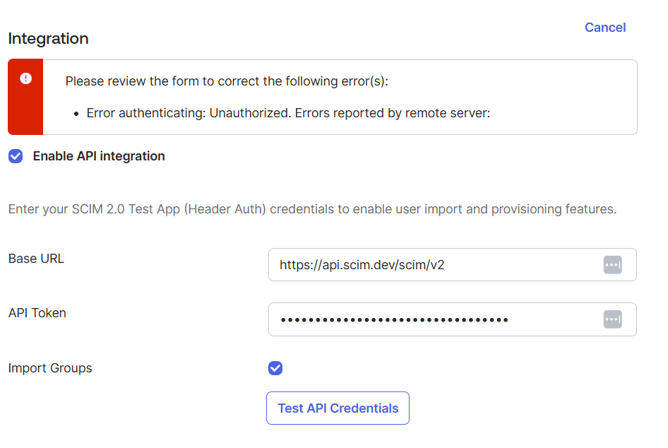
- **Setup:** OIN catalog app *SCIM 2.0 Test App (Header Auth)*, API Token field.
- **Cause:** I entered the plain token, but scim.dev expects `Authorization: Bearer <token>`, and the catalog app sends the field exactly as typed.
- **Fix:** enter `Bearer scim_free_access_token_playground` → ✅ verified.

  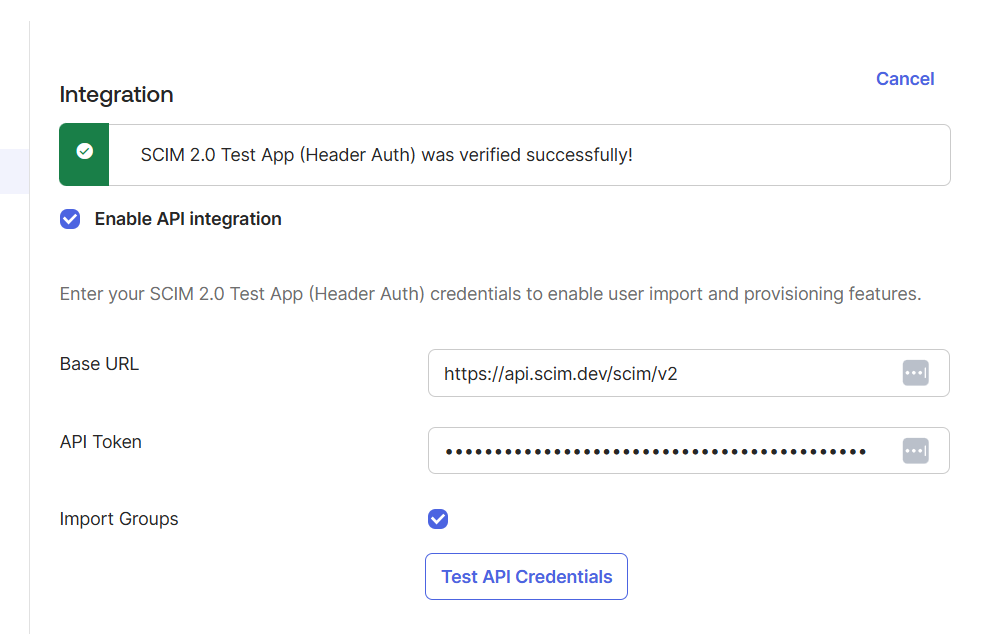

### Issue 2: 400 Bad Request "Invalid data!" on user creation
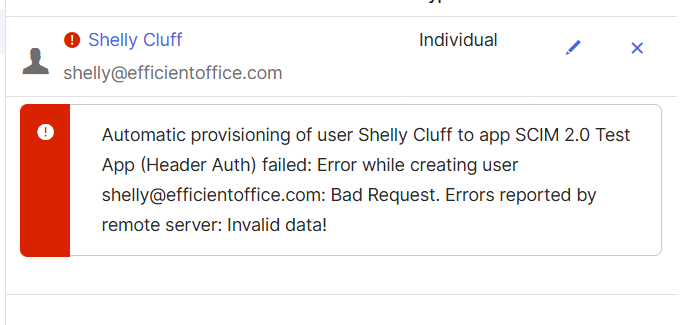
- **What I tried, in order:**
  1. Turned off "Set password when creating new users" → still 400
  2. Fixed the token → still 400 (which proved auth was fine and the **payload** was the problem)
  3. Switched from the catalog app to a **custom SCIM app**, which Okta's support article uses for scim.dev → **still 400** ([screenshot](screenshots/error-04-custom-app-invalid-data.png))
  4. **Assigned a different user** → ✅ success
- **Finding:** failures happened only with **pre-built demo users** (`@efficientoffice.com`). A user with a minimal profile (Kobe Bryant) provisioned cleanly. My first theory was that the username and email didn't match, but a demo user whose username and email *did* match (Christina) also partly failed. The most likely cause is an extra populated attribute in the demo profiles that scim.dev's simulated plan rejects.
- **Lesson:** when provisioning fails, **test a second user** before changing the connector. That separates a *data* problem from a *configuration* problem.

### Issue 3: "Create Users" accidentally disabled
- When I went to turn off the password option, I unchecked **Create Users** itself. The "Set password" sub-option only appears while Create Users is checked.
- **Fix:** re-check Create Users and uncheck only the sub-option.

### Issue 4: 401 Unauthorized again (custom app)
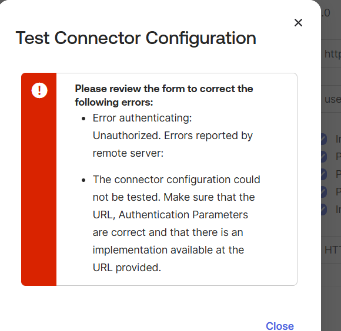
- **Cause 1:** the custom app's Authorization field has a **built-in grey "Bearer" prefix**, so typing "Bearer <token>" sent `Bearer Bearer <token>`. This is the **opposite** of the catalog app.
- **Cause 2:** after removing "Bearer", the test still failed until I **typed the token by hand**. Copy and paste had picked up a hidden character.

### Issue 5: Assignments tab looked clean, but the log showed failures
- Christina showed no red icon at first, but the **System Log** showed `Push new user` SUCCESS, then a FAILURE and a sync FAILURE.
- **Lesson:** don't trust the Assignments UI alone. **The System Log is the source of truth.**

### Quick reference

| Error | Meaning | Where to look |
|---|---|---|
| 401 Unauthorized | Credentials or header format wrong | Bearer prefix (typed vs. built-in), hidden characters |
| 400 Bad Request / Invalid data | Server rejected the user payload | User profile data, attribute mappings; try another user |
| "No user returned for user &lt;id&gt;" | The target can't find the user it created | Non-persistent or reset target, deleted user |

---

## 🔐 Design Decision: HTTP Header (Bearer) vs. OAuth 2.0

I used **HTTP Header** with a static bearer token because scim.dev's free plan provides one, and fewer moving parts made debugging easier.

| | Static bearer token | OAuth 2.0 |
|---|---|---|
| Token lifetime | Long-lived until rotated | Short-lived, auto-refreshed |
| If leaked | Valid until revoked | Expires quickly |
| Setup | Paste a token | Client ID/secret, authorize and token URLs |

**In production, OAuth 2.0 is preferred** when the app supports it. Many SaaS SCIM APIs still use static tokens, which then need a rotation process.

---

## 💡 Key Takeaways

- **SCIM = lifecycle automation.** Assigning, updating, and unassigning in Okta maps directly to `POST`, `PUT/PATCH`, and `active:false` in the app.
- **A 401 vs. a 400 tells you where to look:** a 401 is an auth problem; a 400 means auth worked and the data was rejected.
- **Auth header formats differ by connector.** The catalog app needed `Bearer ` typed in; the custom app adds it for you.
- **Test with a second user** to separate data problems from config problems.
- **The System Log is the source of truth**, not the Assignments tab.
- **Know your test environment's limits.** A non-persistent target can't confirm updates; in production you'd validate against the real app.

## 🔜 Next Steps

- Compare the demo user and clean user profiles in **Profile Editor → Mappings** to find the exact rejected attribute
- Repeat the mover and leaver tests against a **persistent** SCIM server
- **Group Push** to the SCIM app
- Redo the integration with **OAuth 2.0** authentication

## 📎 Appendix

- Full chronological notes: [LAB-LOG.md](./LAB-LOG.md)
- Early catalog-app screenshots: [app added](screenshots/01-app-added.png), [To App settings](screenshots/03-to-app-settings.png)

## 📚 References

- [Okta Support: Create a test Okta SCIM integration with the SCIM Playground](https://support.okta.com/help/s/article/create-a-test-okta-scim-integration-with-the-scim-playground)
- [Okta Developer: Build a SCIM provisioning integration](https://developer.okta.com/docs/guides/scim-provisioning-integration-overview/main/)
- [RFC 7643: SCIM Core Schema](https://datatracker.ietf.org/doc/html/rfc7643) · [RFC 7644: SCIM Protocol](https://datatracker.ietf.org/doc/html/rfc7644)
